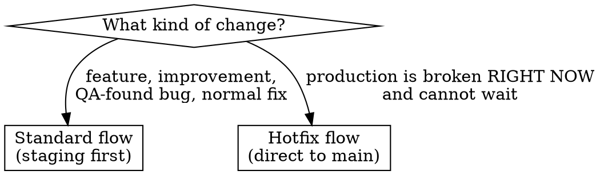

# Ship Changes — ALPHA CRM Deployment Workflow

The project runs two live environments, both auto-deployed from GitHub. Every code change MUST follow the flow below. Never push directly to `main` or `staging`.

## Branch Model

| Branch | What it maps to | Auto-deploys to |
|---|---|---|
| `main` | **Production** | Vercel prod FE + Render prod BE + Supabase prod DB |
| `staging` | **Staging (QA)** | Vercel staging FE + Render staging BE + Supabase staging DB |
| `feat/*`, `fix/*` | Feature branches | Vercel preview URL on PR |
| `hotfix/*` | Emergency prod fixes | Vercel preview URL on PR |

## When to Use This Skill

Trigger whenever the user:
- Says "push this", "ship it", "deploy", "merge", "promote", "release"
- Finishes a feature and is ready to integrate
- Asks how to get a change into staging or prod
- Reports production is broken and needs a hotfix
- Mentions rollback, reverting, or undoing a deploy

## Decision: Which Flow?



**Default is Standard flow.** Only use Hotfix if production is actively broken for users — not for "urgent features."

## Standard Flow (99% of changes)

```
staging              feat/thing               staging               main
   │                    │                       │                    │
   │ ◀── branch off ────┤                       │                    │
   │                    │ work + commits        │                    │
   │                    │ PR into staging ─────▶│                    │
   │                    │                       │ merge → deploys    │
   │                    │                       │ QA tests ✓         │
   │                    │                       │ PR into main ─────▶│
   │                    │                       │                    │ merge → deploys
```

**Exact steps:**

1. **Pick the base with the gate, then branch** (see `docs/agents/issue-tracker.md`)
   ```bash
   git fetch origin main staging
   git merge-base --is-ancestor origin/main origin/staging && BASE=main || BASE=staging
   git checkout -b feat/<short-name> origin/$BASE
   ```
   `main` is the target base, but it only works once `main` is an ancestor of `staging`. Until then a
   `main`-based branch diffs against a 2026-07-03 merge base and its PR into `staging` shows thousands
   of phantom files. Do **not** substitute `git diff --stat origin/main origin/staging` for this gate -
   close trees do not make the diff clean, only shared history does.

2. **Work + commit.** Use the `git-pushing` skill for the commit-and-push mechanics.

3. **Open PR into `staging`** (not main)
   ```bash
   gh pr create --base staging --title "feat: <description>" --body "..."
   ```
   Vercel will auto-post a preview URL in the PR. Click it and verify before merging.
   The body says where the video proof will come from (`pr-video-proof` skill): `Video: posted here after
   merge to staging`, or `No video: <reason>` for a change with nothing to show.

4. **Merge the PR.** Staging auto-deploys. Confirm:
   - Vercel staging build succeeded
   - Render staging service is live
   - Any Prisma migrations applied cleanly

5. **QA on staging.** Real URLs, real Supabase staging DB. If QA reports a bug, fix on another branch off the gate's base and repeat from step 1.
   Record the change working on staging and post the video on the merged PR (`pr-video-proof` skill). That
   video is the QA evidence Ran reviews before he asks for the promotion.

6. **Offer the promotion - do not open it.** Once the staging PR is merged and verified, tell Ran the
   change is ready to promote and **wait for him to ask**. Promotion to `main` happens only on his
   explicit say-so in the current session; approval for one never carries to the next.

7. **Promote per-change, not as a bulk release.** When he asks, cherry-pick the merged staging commit
   with `-x` onto a fresh `main`-based branch and open a second PR into `main`:
   ```bash
   git worktree add ../alpha_crm-worktrees/<slug> -b promote/<slug> origin/main
   git -C ../alpha_crm-worktrees/<slug> cherry-pick -x <merged-staging-sha>
   gh pr create --base main --head promote/<slug> --title "<same conventional-commit line>"
   ```
   The promotion PR's body links the change's video proof from its staging PR (`pr-video-proof` skill),
   or says why there is none.
   Do **not** open `--head staging --base main`; that is the bulk-release shape the per-change flow
   replaced. Before assuming the change stands alone, check what the target files actually contain on
   `main` - promoting a fix whose dependency is still only on `staging` lands broken code on prod.
   Re-run typecheck and the suite on the promotion branch: it is built against `main`'s dependency set,
   which can differ from staging's.

   **Mobile sweep first.** If the promotion carries mobile-programme work (or any change under
   `frontend/`), run `npm run test:mobile:sweep` in `frontend/` on the staging commit being promoted,
   then `npm run test:mobile:sweep:check` (add `-- --sha <commit>` for a cherry-pick). Do not open the
   PR to `main` until the check passes; quote the report's path and first lines in the PR body. What it
   runs, where the report is kept and what passes: `docs/promotion-parity-check.md`, axis 5. In a fresh
   worktree the first sweep also needs `npx prisma generate` in `backend/` and both `.env` files copied in.

## Post-merge cleanup (after a PR merges into `staging`)

Once a change's `staging` PR is merged, clear its ephemeral artifacts:

1. **Delete the merged branch.** Integrated work is safe to remove
   (`git push origin --delete <branch>`; local via `git branch -d`). MERGED branches only -
   never a branch with an open PR, and never Ran's long-lived/personal branches (`main`, `staging`,
   `servwave*`, the `emanuel*` set); Ran owns those merges and deletes. Squash-merges hide in git
   ancestry - cross-check `gh pr list --state merged` first. (Full policy: the branch-deletion feedback.)
2. **Remove the worktree** if the work used one (bug-fix flow, per `docs/agents/issue-tracker.md`):
   `git worktree remove ../alpha_crm-worktrees/<branch>`. These are throwaway agent workspaces - safe to
   remove once their PR has merged; promotion to `main` cherry-picks from the staging commit, not the worktree.
3. **Retire the plan file** in `md_files/plans/{module}/` only once the plan is FULLY shipped - every PR it
   describes has merged, not just the first. Many plans are multi-round epics (R0-R8, multi-task); deleting on
   the first merge would destroy the roadmap for the remaining rounds, and uncommitted plans have no git history
   to recover from. Single-PR plan = same moment. When in doubt, leave it.

## Hotfix Flow (emergency only)

Use ONLY when production is broken and cannot wait for staging validation.

```bash
git checkout main && git pull
git checkout -b hotfix/<short-name>
# make minimal fix + commit
gh pr create --base main --title "hotfix: <description>"
# merge → prod deploys
```

**CRITICAL:** Immediately after the hotfix merges, sync staging so it doesn't fall behind. Because `staging` is branch-protected (PR required, no direct pushes), sync via a PR — not a direct merge push:
```bash
gh pr create --base staging --head main --title "sync: post-hotfix from main" --body "Bring staging back in sync with main after a hotfix."
```
Then merge that PR. Do NOT try `git push origin staging` — branch protection will (correctly) reject it.

## Rollback

**Code rollback (safe, always first option):**
- **Render:** dashboard → service → Events → click "Rollback" on last known good deploy
- **Vercel:** dashboard → Deployments → find previous deploy → "Promote to Production"
- Both are one click and take <60 seconds

**Code-level revert via git (if platform rollback isn't enough).** `main` is branch-protected, so revert goes through a PR — not a direct push:
```bash
git checkout main && git pull
git checkout -b revert/<bad-sha-or-description>
git revert <bad-commit-sha>
git push -u origin revert/<bad-sha-or-description>
gh pr create --base main --title "revert: <description>" --body "Reverting <sha>; platform rollback insufficient."
```
Merge → prod auto-deploys the revert. Then sync `staging` back from `main` via another PR (`gh pr create --base staging --head main --title "sync: post-revert from main"`) to keep envs aligned.

**Database rollback:** DO NOT attempt automated migration rollback. Surface to the user. In Phase 0 staging can be reseeded from Prisma migrations + tax-rate seed; prod requires manual recovery with the user in the loop.

## Migrations

- Prisma migrations live in `backend/prisma/migrations/` and are committed to git
- Render runs `npx prisma migrate deploy` on every backend deploy — migrations apply against the correct DB per env because `DATABASE_URL` is different per env
- **NEVER edit a migration that has already been deployed** — create a new one instead

## Red Flags — STOP if you hear these

| Phrase | Correct response |
|---|---|
| "Just push directly to main, it's faster" | NO — always via PR, even for one-line changes |
| "Skip staging, I've tested locally" | NO — staging exists because local differs from production |
| "Let me edit that old migration" | NO — create a new migration |
| "Amend that commit on main" | NO — main history is protected, create a new commit |
| "This is urgent, do a hotfix" | Ask: is production *actually broken for users right now?* If no → standard flow |
| "Skip the QA check on staging" | NO — QA on staging is why staging exists |

## Commit Messages

Use conventional commits (matches project convention in CLAUDE.md):
- `feat: add reports page`
- `fix: correct deposit refund calculation`
- `hotfix: stripe webhook 500 on missing payment_intent`
- `chore: bump deps`
- `refactor: extract invoice PDF renderer`

Never include AI attribution (`Co-Authored-By: Claude`, "Generated with", etc.) per CLAUDE.md rule 8.

## Cost Awareness

- **Staging:** Render Starter ($7/mo, always-on) + Vercel Hobby + Supabase Free = $7/mo
- **Production:** Render Free (keep-alive'd) + Vercel Hobby + Supabase Free = $0/mo until go-live
- **Go-live day:** flip prod Render to Starter (+$7), add domain, upgrade Vercel if needed

See `md_files/plans/project/2026-04-23-prod-env-setup-design.md` for full architecture.
